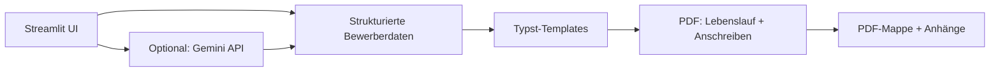

# LebenslaufPro

**Streamlit app for building German application documents (CV + cover letter)** from structured data, rendered with Typst and merged into a single PDF.

## Projektüberblick (DE)

LebenslaufPro führt Schritt für Schritt durch die Erstellung einer deutschen
Bewerbungsmappe. Nutzer erfassen persönliche Daten, Berufserfahrung,
Ausbildung, Kenntnisse und Anhänge; die App erzeugt daraus einen Lebenslauf
und optional ein Anschreiben. Das Layout wird mit Typst gesetzt und die
Dokumente werden zu einer PDF-Mappe zusammengeführt.

## Funktionen

- Geführter Workflow in mehreren Schritten
- Drei Layout-Varianten: Classic, Modern, Executive
- Lebenslauf und Anschreiben aus denselben Daten
- KI-gestützte Vorausfüllung aus einer bestehenden PDF/DOCX (optional)
- Foto-Upload und Zuschnitt
- Anhänge (Zeugnisse, Zertifikate) zur Mappe hinzufügen
- PDF-Export als einzelne Dokumente oder komplette Bewerbungsmappe

## Architektur



- **Frontend/Workflow:** Streamlit
- **Layout:** Typst-Templates
- **PDF-Verarbeitung:** pypdf
- **Optionale KI:** Google Gemini API
- **Sprache:** Python

## Setup

```bash
python -m venv .venv
source .venv/bin/activate        # Windows: .venv\Scripts\activate
pip install -r requirements.txt
streamlit run app.py
```

Für die optionale KI-Vorausfüllung wird ein Gemini-API-Key benötigt:

```toml
# .streamlit/secrets.toml
GEMINI_API_KEY = "your_api_key_here"
```

Alternativ kann der Key über die Umgebungsvariable `GEMINI_API_KEY` gesetzt
werden. Die App funktioniert auch ohne KI-Key; dann werden die Daten manuell
erfasst.

## Projektstruktur

```text
app.py                     Streamlit-Workflow
generator.py               Typst-Kompilierung und PDF-Zusammenführung
llm_manager.py             Optionale KI-Extraktion/Formatierung
*_lebenslauf.typ           CV-Templates
*_anschreiben.typ          Cover-Letter-Templates
requirements.txt
```

## Status

Funktionsfähiger Prototyp mit drei Layouts und PDF-Export. Die Templates sind
auf deutsche Bewerbungsstandards ausgelegt.

## Links

- **GitHub:** https://github.com/Musn0o/LebenslaufPro
